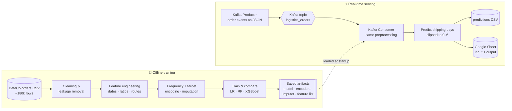
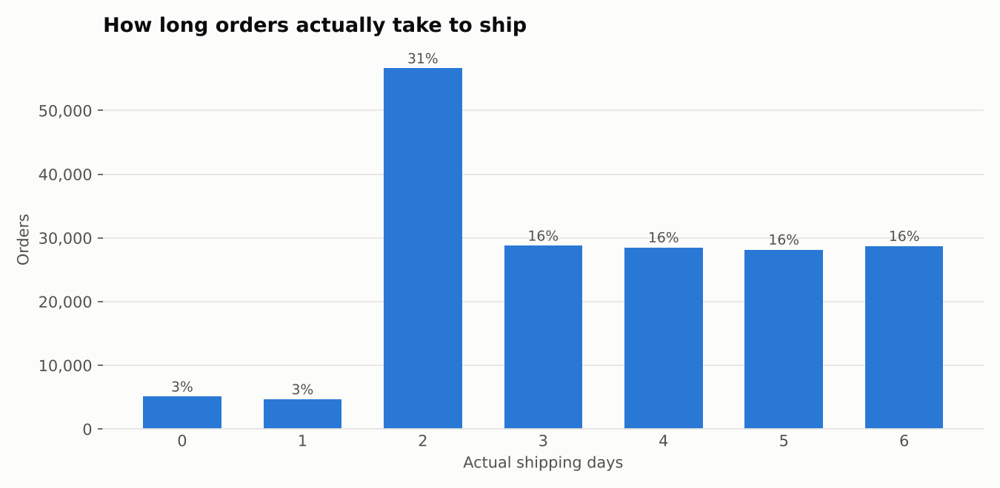
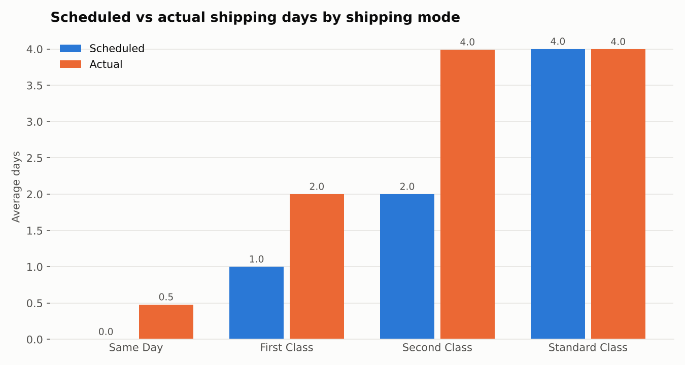

# 🚚 Real-Time Delivery Time Prediction with Apache Kafka

### An end-to-end streaming ML pipeline: a regression model trained on 180k supply-chain orders, served live by a Kafka consumer that predicts shipping time for each incoming order

> [!NOTE]
> This is the **client project** , so the source code, credentials and trained models stay private. This repository only describes the architecture and what I learned. The underlying dataset is public (see [Dataset](#-dataset)).

---

## 📌 Table of Contents
- [Overview](#-overview)
- [Highlights](#-highlights)
- [Architecture](#-architecture)
- [Dataset](#-dataset)
- [ML Pipeline](#-ml-pipeline)
- [Models & Results](#-models--results)
- [Streaming Layer](#-streaming-layer)
- [Tech Stack](#-tech-stack)
- [Key Learnings](#-key-learnings)
- [Limitations & Next Steps](#-limitations--next-steps)

---

## 🔭 Overview

E-commerce and logistics teams need to know **how long an order will take to ship** as soon as it is placed, not after the fact. This project combines two parts:

1. **An offline ML pipeline** that learns to predict **actual shipping days (0–6)** from order, product, customer and route attributes.
2. **A real-time streaming layer on Apache Kafka.** Orders are published to a topic, and a consumer service applies **the same feature engineering**, scores each order with the trained model, and writes the predictions to a CSV log and a **live Google Sheet**.

It's a small but complete example of taking a model **from a notebook to an event-driven service**.

---

## ✨ Highlights

- 📦 Trained on **~180k orders with 53 attributes** from a public supply-chain dataset.
- 🛡️ **Removed leaking columns**: delivery status, late-delivery flag, shipping date and order status are all only known *after* shipping, so they were dropped.
- 🧩 Engineered **date, pricing, international-order and route features** (e.g. *region × shipping mode*), plus **frequency** and **target encoding** fit on training data only.
- 🤖 Compared **Linear Regression, Random Forest and XGBoost**. The **Random Forest** performed best, at about **0.8 days MAE**.
- ⚡ **Kafka (KRaft mode, Docker)** streams orders; a Python consumer scores each one **in real time**.
- 📊 Predictions go to **CSV and Google Sheets** through a service account, ready for business users.
- 🔁 **Training–serving parity**: the encoders, imputer, frequency maps and feature list are all saved, so live predictions get exactly the same preprocessing as training.

---

## 🏗️ Architecture

| Component | Role |
|---|---|
| **Kafka broker** | Single-node Apache Kafka in **KRaft mode** (no ZooKeeper) via Docker Compose, with 3 partitions |
| **Producer** | Reads orders and publishes each one as a JSON message to `logistics_orders` |
| **Consumer** | Subscribes to the topic, rebuilds the features, applies the saved encoders and imputer, and predicts |
| **Sinks** | Local CSV log, plus a Google Sheet where each row holds the order's input fields and the prediction |

---

## 🗂️ Dataset

### Source: *DataCo SMART SUPPLY CHAIN FOR BIG DATA ANALYSIS*, Constante, Silva & Pereira (2019)

| Resource | Link |
|---|---|
| 📦 Dataset (Mendeley Data, official) | https://data.mendeley.com/datasets/8gx2fvg2k6/5 |
| 🔖 DOI | [10.17632/8gx2fvg2k6.5](https://doi.org/10.17632/8gx2fvg2k6.5) |
| 📘 Kaggle mirror | https://www.kaggle.com/datasets/shashwatwork/dataco-smart-supply-chain-for-big-data-analysis |

This public supply-chain dataset comes from the company **DataCo Global**. It covers **clothing, sports and electronics** products and is published for machine-learning and big-data analysis. It includes a companion file, `DescriptionDataCoSupplyChain.csv`, that describes every variable. License: **CC BY 4.0**.

### Dataset profile

| Property | Value |
|---|---|
| File used | `DataCoSupplyChainDataset.csv` (structured orders) |
| Records | **180,519** order lines |
| Columns | 53 |
| Period | 2015 – 2018 |
| Target | `Days for shipping (real)`: actual shipping days, **0 to 6** |
| Duplicates | 0 |

### Key field groups

| Group | Example columns | Used? |
|---|---|---|
| Shipping | `Shipping Mode`, `Days for shipment (scheduled)` | ✅ Known when the order is placed |
| Order & pricing | `Sales`, `Order Item Quantity`, `Order Item Discount`, `Order Profit Per Order` | ✅ |
| Product | `Category Name`, `Department Name`, `Product Name`, `Product Price` | ✅ |
| Geography | `Market`, `Order Region`, `Order Country`, `Customer Country`, `Latitude/Longitude` | ✅ |
| **Outcome (leakage)** | `Delivery Status`, `Late_delivery_risk`, `shipping date`, `Order Status` | ❌ **Dropped** |
| Personal / IDs | Customer name, email, password, street, IDs, zip codes | ❌ Dropped |

### A look at the public data

  
  

**Shipping mode drives everything.** First Class and Second Class orders take about **twice their scheduled time** on average, while Standard Class lands on schedule. Overall, **about 55 % of orders are flagged as late**, which is why predicting real shipping time matters.

---

## 🔬 ML Pipeline

| Step | What was done |
|---|---|
| **Cleaning** | Standardised column names, checked for duplicates (none), parsed order and shipping dates |
| **Leakage removal** | Dropped every post-shipment field (delivery status, late-risk flag, shipping date, order status) plus personal data and IDs |
| **Date features** | Year, month, day, day of week, hour, ISO week, quarter, weekend flag, time-of-day period, season |
| **Business features** | Sales per unit, discount per unit, profit margin, discount ratio, post-discount value ratio |
| **Route features** | `is_international_order`, *region × shipping mode*, *country × shipping mode*, *category × shipping mode* |
| **Split** | 80 / 20 **stratified** train/test split on the target (~144k / ~36k) |
| **Encoding** | **Frequency encoding** for high-cardinality locations, products and routes, plus **target encoding** (smoothing = 10) for all categoricals. Both fit **on training data only** |
| **Imputation & scaling** | Median imputation; standard scaling for the linear model only |
| **Post-processing** | Predictions **clipped to the valid 0–6 day range** |

---

## 📊 Models & Results

Test set (~36k orders), rounded:

| Model | MAE (days) | RMSE (days) | R² |
|---|---:|---:|---:|
| 🥇 **Random Forest** (250 trees, depth 25) | **~0.82** | **~1.09** | **~0.55** |
| XGBoost (600 trees, lr 0.03, depth 6) | ~0.92 | ~1.20 | ~0.45 |
| Linear Regression | ~1.01 | ~1.26 | ~0.40 |

**What drives predictions** (Random Forest feature importance):
1. **Country × shipping-mode route**
2. **Shipping mode**
3. **Category × shipping-mode route**
4. **Region × shipping-mode route**
5. **Scheduled shipping days**

These are followed by order-city, location and order-time features. The **engineered route features ranked above almost every raw column**, which confirms that the delivery promise depends on *where* and *how* an order ships.

**Interpretation:** the Random Forest predicts shipping time to within **about 0.8 days** on average, a clear improvement over the linear baseline. R² is about 0.55, so a large part of the day-to-day variation within each shipping mode is still unexplained by the order attributes. See [Limitations](#-limitations--next-steps).

---

## ⚡ Streaming Layer

**Kafka setup:** `apache/kafka` in **KRaft** combined broker/controller mode, run with Docker Compose. The topic has 3 partitions and the broker is exposed on `localhost:9092`.

**Producer:**
- Reads order records and serialises each row to **JSON**
- Publishes to the `logistics_orders` topic, one message at a time with a short delay, to **simulate a live order feed**

**Consumer (prediction service):**
1. Loads the saved **model, target encoder, imputer, frequency maps and feature list** at startup
2. Polls the topic (consumer group, `auto.offset.reset = earliest`)
3. For each message, it rebuilds the **same features as training**, drops leakage and personal-data columns, aligns to the training feature order, then encodes and imputes
4. Predicts shipping days, clips the result to 0–6, and logs the order ID, shipping mode, countries and prediction
5. Writes results to a **CSV**, and in a second variant to a **Google Sheet** through a **service account** (`gspread`). Each row holds all the input fields plus the prediction and a timestamp, and new columns are added automatically if the schema changes

---

## 🛠️ Tech Stack

| Area | Tools |
|---|---|
| Language | Python |
| Streaming | Apache Kafka (KRaft), `confluent-kafka` Python client |
| Infrastructure | Docker Compose |
| Data | pandas, NumPy |
| ML | scikit-learn (Random Forest, Linear Regression, imputation, scaling), XGBoost, `category_encoders` (TargetEncoder) |
| Serialisation | joblib (model and preprocessing artifacts), JSON (Kafka messages) |
| Output | CSV, Google Sheets API (`gspread`, Google service-account auth) |
| Visualisation | Matplotlib, Seaborn |

---

## 💡 Key Learnings

- **Training–serving skew is the real risk in production ML.** Saving every fitted transformer (encoders, imputer, frequency maps, feature order) and reusing it in the consumer was essential to get the same predictions live as in the notebook.
- **Watch for leakage in business datasets.** Columns like *Delivery Status* and *Late_delivery_risk* make a model look perfect but are only known *after* delivery. Removing them gives an honest model.
- **Feature engineering beat model complexity.** The route features (*country × shipping mode*) were the top predictors, and the tuned Random Forest outperformed XGBoost on this data.
- **Know the ceiling of your data.** Within a shipping mode, actual shipping days are spread almost evenly across several values, which limits how much any model can explain.
- **Streaming design basics:** decouple producers and consumers with a topic, use consumer groups and offsets, and serialise messages as JSON.
- **Handle credentials like secrets.** Service-account keys belong in environment variables or a secret manager, never in source control.

---

## ⚠️ Limitations & Next Steps

- **R² of about 0.55:** much of the remaining variance in shipping days isn't captured by the order attributes. Classification (*on time vs late*) or ordinal models may suit this target better.
- The split is **random and stratified, not time-based**. A chronological split would better reflect forecasting future orders.
- The demo streams a **sample of historical orders**. Next steps are containerising the consumer, adding schema validation (e.g. Avro with a Schema Registry), monitoring prediction drift, and exposing results on a dashboard.

---

## 🙏 Data Acknowledgement

Constante, F., Silva, F., & Pereira, A. (2019). *DataCo SMART SUPPLY CHAIN FOR BIG DATA ANALYSIS*. Mendeley Data, V5. doi:10.17632/8gx2fvg2k6.5

---

**🔒 (client project) Source code is private 

